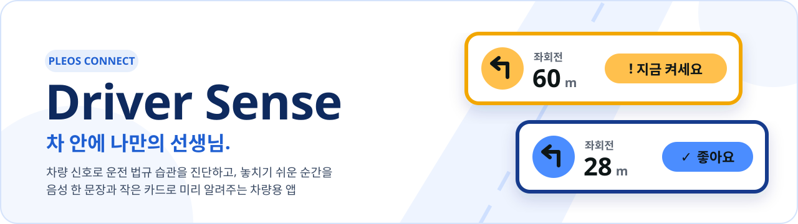
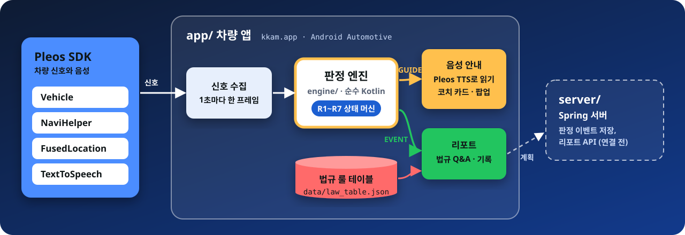
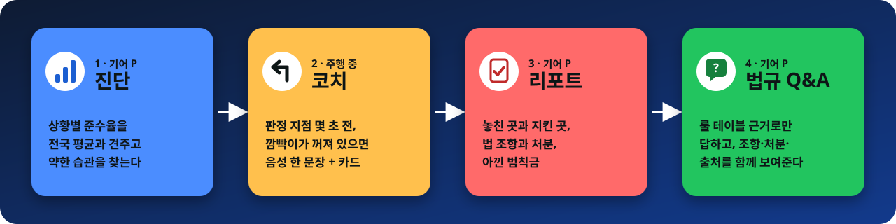
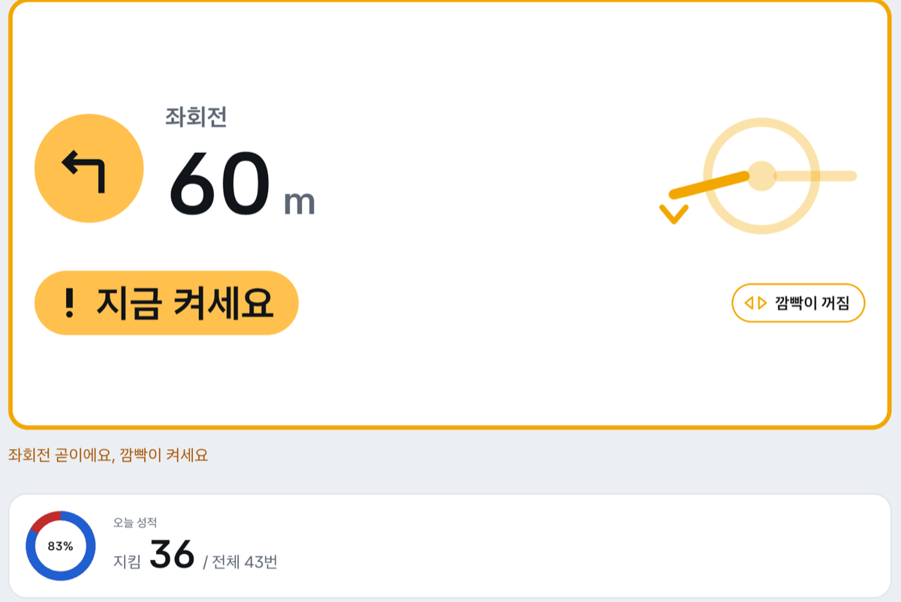
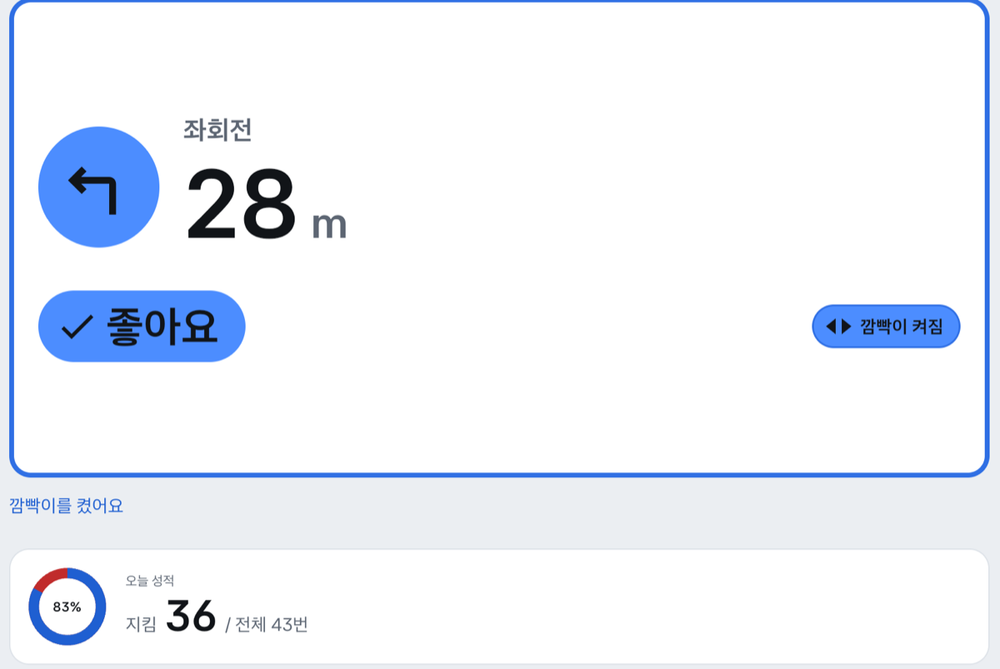
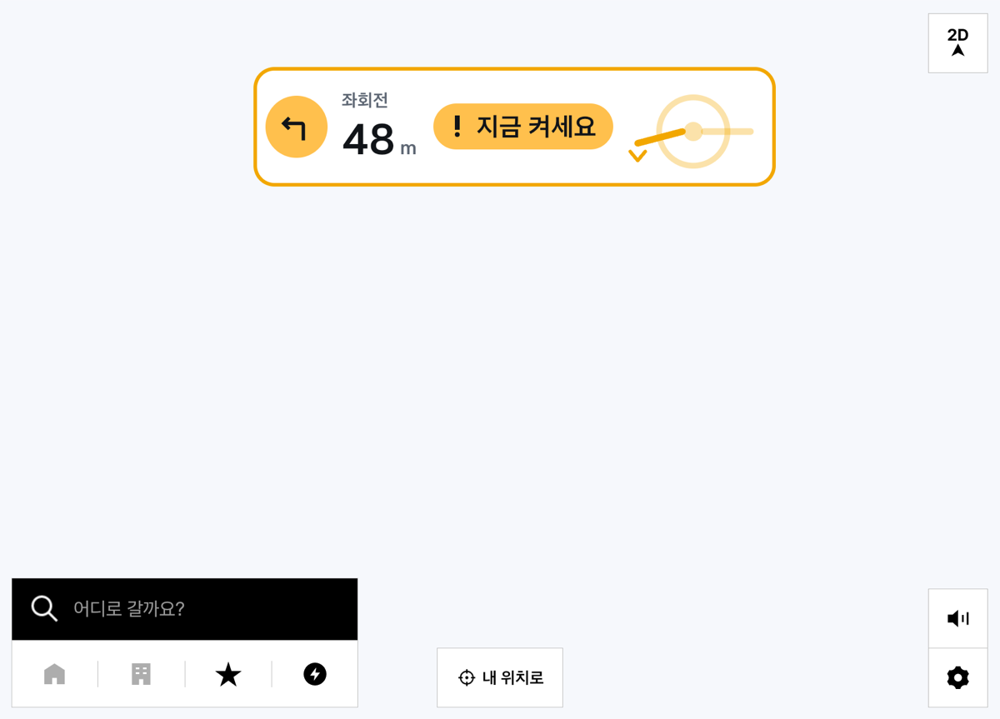
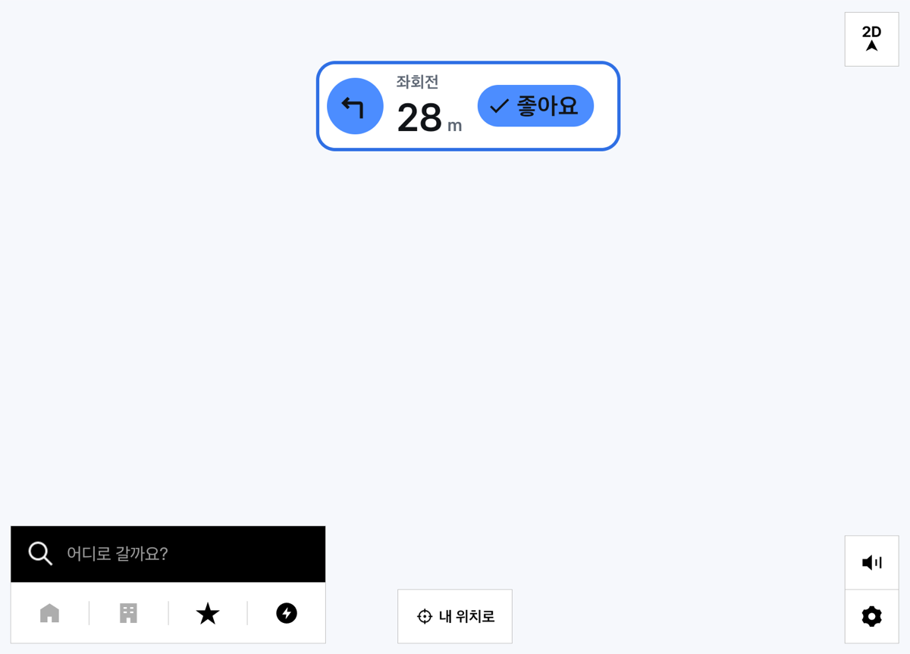
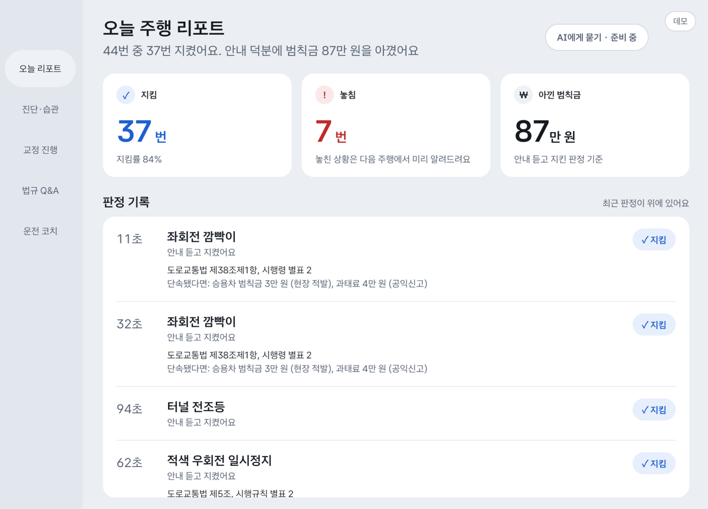
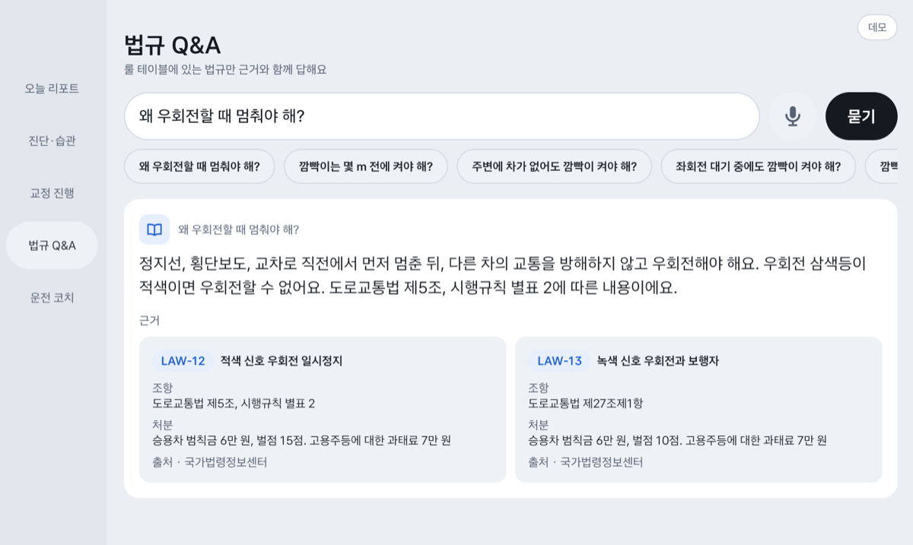

<!-- 룰·시나리오 수나 SDK 판을 바꾸면 배지, '하는 일'의 룰 표, '실행 환경' 표를 같이 고친다 -->
<div align="center">



<br>

차량 신호로 운전 법규 습관을 진단하고, 단속되기 전에 미리 알려주는 **Pleos Connect 차량용 앱**이다.<br>
판정은 차 안에서 규칙(상태 머신)으로 하고, 결과는 음성 한 문장과 카드, 리포트로 보여준다.

[](#실행-환경)
[](#실행-환경)
[](#실행-환경)
[](#실행-환경)
<br>
[](#하는-일)
[](#데모로-보기)
[](#실행-환경)
[](#소스에서-빌드)

</div>

> [!NOTE]
> 현대자동차그룹 차량용 앱 개발 공모전(Pleos Playground) 출품작이다.
> - Pleos Connect Emulator의 내비는 경로를 정해도 위치가 움직이지 않는다. 그래서 주행 장면은 녹화된 차량 신호를 재생해서 보여준다([데모로 보기](#데모로-보기)). 판정 엔진은 실제 신호와 재생 신호를 똑같이 처리한다.
> - 아직 완성되지 않은 부분은 [현재 한계](#현재-한계)에 모아 두었다.

처음 본다면 [시스템 구성](#시스템-구성) → [하는 일](#하는-일) → [실행 환경](#실행-환경) → [빌드와 실행](#빌드와-실행) → [데모로 보기](#데모로-보기) 순서로 읽는다.

## 시스템 구성



1. 앱이 차량 신호를 1초마다 한 프레임(`SignalFrame`)으로 묶어 판정 엔진에 넣는다.
2. 엔진은 프레임마다 룰 7개를 검사해 두 가지를 낸다. 지금 말할 문구(GUIDE)와, 법규를 지켰는지 놓쳤는지(EVENT)다.
3. 앱은 GUIDE를 Pleos TTS로 읽고 코치 카드에 보여준다. 주행 중 내비가 앞에 있으면 내비 위에 작은 팝업으로 띄운다.
4. EVENT는 기기에 저장하고, 기어 P에서 리포트로 보여준다. 조항·처분은 법규 룰 테이블에서 붙인다.
5. 판정에 LLM을 쓰지 않는다. 같은 주행에는 언제나 같은 결과가 나와서 시나리오로 검증할 수 있다.

## 하는 일

운전자가 겪는 흐름은 **진단 → 코치 → 리포트 → 법규 Q&A**다.



1. **진단**: 정차 중(기어 P) 상황별 준수율을 전국 평균(75.7%)과 견주어 보고, 어떤 습관이 약한지 확인한다.
2. **코치**: 출발하면 화면은 내비가 차지하고 앱은 뒤에서 판정한다. 회전·나들목·터널에 다가가는데 깜빡이나 전조등이 꺼져 있으면 음성 한 문장과 카드로 알려준다. 켜면 카드가 "좋아요"로 바뀌고 곧 사라진다.
3. **리포트**: 도착해 기어를 P로 두면 앱이 앞으로 와서 지킨 곳과 놓친 곳, 조항과 처분, 안내 덕분에 아낀 범칙금을 보여준다.
4. **법규 Q&A**: 리포트의 "AI에게 묻기"로 넘어가 묻는다. 답은 룰 테이블 근거 안에서만 만들고, 근거가 없으면 "확인된 근거가 없어요"라고 답한다.

**화면으로 보기**

아래는 Pleos Connect Emulator에서 데모 시나리오를 재생하며 찍은 실제 앱 화면이다(앱 칸만 잘랐다).

<table>
  <tr>
    <td width="50%"></td>
    <td width="50%"></td>
  </tr>
  <tr>
    <td><b>🟡 지금 켜세요</b><br>좌회전 60 m 앞인데 깜빡이가 꺼져 있다. 노랑 카드와 음성 한 문장 "좌회전 곧이에요, 깜빡이 켜세요", 어느 레버를 어떻게 움직이는지 그림으로 알려준다.</td>
    <td><b>🔵 좋아요</b><br>깜빡이를 켜면 카드가 파랑으로 바뀐다. 30 m 판정 지점과 회전 완료를 지나면 지킴으로 기록하고, 아래 오늘 성적에 더한다.</td>
  </tr>
  <tr>
    <td></td>
    <td></td>
  </tr>
  <tr>
    <td colspan="2"><b>🧭 내비 위 팝업</b><br>주행 중에는 내비가 화면을 차지한다. 앱은 뒤에서 판정하다가 안내가 필요한 순간에만 내비 위쪽에 작은 카드를 띄우고, 켜면 "좋아요"로 바꾼 뒤 3초 뒤 지운다.</td>
  </tr>
  <tr>
    <td></td>
    <td></td>
  </tr>
  <tr>
    <td><b>📋 오늘 주행 리포트</b><br>기어를 P로 두면 열린다. 지킴·놓침·아낀 범칙금을 숫자로, 판정마다 법 조항과 "단속됐다면" 받을 처분을 보여준다.</td>
    <td><b>💬 법규 Q&A</b><br>룰 테이블에서 근거를 찾아 답하고, 조항·처분·출처를 근거 카드로 붙인다. 근거가 없으면 "확인된 근거가 없어요"라고 답한다.</td>
  </tr>
</table>

**판정 룰**

| 룰 | 상황 | 안내 문구 | 법 근거 |
|---|---|---|---|
| R1 | 회전 전 깜빡이 | 좌회전 곧이에요, 깜빡이 켜세요 | 도로교통법 제38조 |
| R2 | 깜빡이 없이 회전 (내비 없이) | 없음 (기록만) | 도로교통법 제38조 |
| R3 | 적색 신호 우회전 일시정지 | 전방 적색이에요, 정지선에서 멈췄다 가세요 | 도로교통법 제5조 |
| R4 | 나들목 진출입 전 깜빡이 | 오른쪽 나들목이 곧이에요, 깜빡이 켜세요 | 도로교통법 제38조 |
| R5 | 터널 진입 전 전조등 | 터널이 곧 나와요, 전조등 켜세요 | 도로교통법 제37조 |
| R6 | 비 올 때 와이퍼 | 비가 와요, 와이퍼 켜세요 | 없음 (안전 안내) |
| R7 | 앞유리 김서림 | 앞유리가 뿌예질 수 있어요, 성에 제거를 켜고 외기로 바꾸세요 | 없음 (안전 안내) |

- 상태 머신, 파라미터, 전이표는 [docs/spec.md](docs/spec.md)에 있다. 조항·처분의 출처와 원문 대조 결과는 [docs/law_table.md](docs/law_table.md)에 있다.
- R4·R5는 놓침을 기록하지 않고 안내 후 따랐을 때만 지킴을 기록한다. R6·R7은 법규 근거가 없어 준수율과 범칙금에서 뺀다.

**화면과 기능**

| 기능 | 하는 것 |
|---|---|
| 주행 화면 코치 카드 | 흰 바탕 카드에 상태 색(노랑 켜세요, 파랑 좋아요, 빨강 놓침)을 테두리·그림·알약에 쓴다. 켜는 방법은 레버·공조 버튼 그림으로 보여준다 |
| 내비 위 팝업 | 내비가 앞에 있을 때 안내가 필요한 순간에만 작은 카드를 띄웠다가 지운다. 권한이 없으면 상단 알림으로 대신한다 |
| 오늘 리포트 | 지킴·놓침, 조항·처분, 아낀 범칙금, 판정 기록 |
| 목적지 경로 코치 | 내비에서 목적지를 정하면 그 경로를 따라 코치한다. 출발 전 경로 미리보기(코치할 곳, 경로 순서, 자주 놓친 유형), 도착 후 그 경로만 묶은 경로 리포트 |
| 법규 Q&A | 질문 입력과 추천 질문, 답변과 근거 카드(조항·처분·출처) |
| 진단 리포트 | 상황별 준수율 막대와 전국 평균선 |
| 교정 진행 | 습관별 졸업 진행, 7일 준수율, 자주 놓친 곳 |
| 운전 코치 켬/끔 | 스위치 하나. 끄면 안내만 멈추고 판정 기록은 남긴다 |

- 주행 중에는 터치할 것을 두지 않는다. 리포트, 진단, 교정 진행, Q&A, 코치 켬/끔은 기어 P에서만 열린다.
- 화면별 자세한 동작은 [app/README.md](app/README.md)에 있다.

## 폴더 구조

```text
.
├── app/                 차량 앱 (Android Automotive, 패키지 kkam.app) · 앱 담당
├── engine/              판정 엔진. Android에 의존하지 않는 순수 Kotlin 라이브러리 (패키지 kkam.engine) · AI 담당
├── scenarios/           주행 시나리오 JSON S1~S24. 엔진 테스트와 앱 데모가 같은 파일을 쓴다
├── data/                법규 룰 테이블 law_table.json (15개 항목). 앱 리포트·Q&A와 엔진 테스트가 같이 쓴다
├── server/              Spring 서버 (판정 이벤트 저장, 리포트 API) · 서버 담당
├── docs/                기획서, 엔진 명세, 법규 룰 테이블 설명, 작업 순서
├── apk/                 제출용 APK 설치 안내 (파일은 Releases)
├── settings.gradle.kts  루트 빌드. :engine, :app 두 모듈
└── CLAUDE.md            엔진 작업 지침 (개발용)
```

- 앱은 `scenarios/`와 `data/`를 복사하지 않고 assets 폴더로 바로 쓴다(`app/build.gradle.kts`). 시나리오를 고치면 엔진 테스트와 앱 데모에 같이 반영된다.
- 서버는 루트 빌드에 들어 있지 않은 독립 빌드로 준비 중이다([server/README.md](server/README.md)).

## 실행 환경

| 항목 | 지금 쓰는 것 |
|---|---|
| 실행 | Pleos Connect Emulator v2.1.0 (2560×1440, 160dpi) |
| 앱 | Android Automotive, minSdk 28, targetSdk 34, compileSdk 36 |
| 빌드 | Gradle Wrapper(Kotlin DSL), Kotlin 2.4, JDK 17, Android SDK |
| Pleos SDK | Vehicle 2.3.2, NaviHelper 3.0.5, FusedLocation 1.1.3, TextToSpeech 3.3.1 (저장소 `https://nexus-playground.pleos.ai/repository/maven-releases/`) |
| 차량 속성 | `android.car`의 `CarPropertyManager` (속도) |
| 지도 | 네이버 지도 Android SDK 3.24.1. 경로 데모의 앱 안 지도에만 쓴다 |
| 엔진 | `kotlinx-serialization-json`, 테스트는 `kotlin-test`(JUnit 5) |

- 위치(`pleos.car.permission.FUSED_LOCATION`)와 속도(`android.car.permission.CAR_SPEED`) 권한은 앱을 처음 켤 때 묻는다.
- SDK별 권한과 값 변환은 [app/README.md의 Pleos SDK 연동](app/README.md#pleos-sdk-연동)에 있다.

## 저장소에 없는 파일

아래 파일은 개인 값이 있어 저장소에 넣지 않는다(`.gitignore`).

| 파일 | 내용 |
|---|---|
| `local.properties` | `sdk.dir`(Android SDK 위치), `NAVER_MAP_CLIENT_ID`(네이버 지도 Client ID) |

- `sdk.dir` 대신 `ANDROID_HOME`을 지정해도 된다. 둘 다 없으면 `./gradlew test`도 실패한다.
- `NAVER_MAP_CLIENT_ID`가 없어도 빌드된다. 경로 데모에서 지도만 안 뜨고 속도와 안내 카드는 보인다. 발급 방법은 [app/README.md의 네이버 지도](app/README.md#네이버-지도)에 있다.
- API 키, 서명 키도 커밋하지 않는다.

## 빌드와 실행

### APK로 실행

제출용 APK는 용량 때문에 [GitHub Releases v0.1](https://github.com/Driver-sense-team/Driver-sense/releases/tag/v0.1)에 있다. 설치 방법은 [apk/](apk/README.md)에 있다.

1. Pleos Connect Emulator를 켠다.
2. 설치하고 실행한다.
   ```bash
   adb install -r --user 10 Driver-sense-team_DriverSense_release.apk
   ```
   ```bash
   adb shell am start --user 10 -n kkam.app/.MainActivity
   ```
   → 처음 켜면 위치·속도 권한을 묻는다. 허용하면 실제 차량 신호로 주행 코치를 시작한다.
3. 내비 위 팝업을 보려면 겹침 창 권한을 켠다. 에뮬레이터에는 이 설정 화면이 없다.
   ```bash
   adb shell appops set --user 10 kkam.app SYSTEM_ALERT_WINDOW allow
   ```
   → 권한이 없으면 같은 내용을 상단 알림으로 보여준다.
4. 기어, 방향지시등, 속도는 에뮬레이터의 Virtual Console에서 바꾼다.
   ```bash
   adb forward tcp:8088 tcp:8088
   ```
   → 브라우저로 `http://127.0.0.1:8088/`을 연다. 기어를 P로 바꾸면 오늘 리포트가 나온다.

### 소스에서 빌드

저장소를 받은 폴더에서 친다.

```bash
./gradlew test :app:testDebugUnitTest
```

→ 엔진 단위 테스트, 시나리오 테스트(S1~S24), 앱 JVM 테스트가 돈다. 엔진만 보려면 `./gradlew :engine:test`.

```bash
./gradlew :app:installDebug
```

→ 켜져 있는 에뮬레이터에 debug 앱을 설치한다. debug 앱에만 데모 패널이 있다.

## 데모로 보기

debug 앱의 오른쪽 위 "데모" 버튼으로 데모 패널을 연다. release 앱에는 이 버튼이 없다.

**시나리오 재생**: 시나리오를 누르면 녹화된 주행 신호를 시간대로 재생한다.

| 시나리오 | 보이는 것 |
|---|---|
| S2 좌회전 안내후 켬 | 좌회전 60m 앞 "좌회전 곧이에요, 깜빡이 켜세요" → 깜빡이를 켜면 파랑 "좋아요" → 회전 후 지킴 기록 |
| S3 좌회전 끝까지 안켬 | 안내 후에도 안 켜서 놓침 기록 |
| S8 판정후 주차 | 기어 P에서 오늘 리포트(지킴·놓침, 조항·처분, 아낀 범칙금) |
| S11 터널 전조등 | 터널 187m 앞 "터널이 곧 나와요, 전조등 켜세요" → 켜면 지킴 기록 |
| S12 나들목 안내후 켬 | 오른쪽 나들목 167m 앞 깜빡이 안내와 레버 그림 → 100m 지점에서 지킴 기록 |

- 전체 목록(S1~S24)과 기대 출력은 [docs/spec.md](docs/spec.md) 4장과 [engine/README.md](engine/README.md)에 있다.
- "재생하면 내비 띄우기"를 켜면 내비를 앞에 둔 채 내비 위 팝업을 볼 수 있다.

**경로 데모**: "경로 데모 (목적지 검색 → 도착)"는 목적지 경로 코치를 처음부터 끝까지 약 3분에 보여준다. 시연용 경로 데이터를 재생하며, 앱 안 지도가 내비 역할을 한다.

1. 목적지를 검색해 고르면 경로 미리보기가 나오고, "출발"을 누를 때까지 기다린다.
2. 출발하면 좌회전, 적색 우회전, 차선 변경, 터널, 나들목, 우회전 순서로 안내와 판정이 나온다. 코치 지점 밖은 빨리 감는다.
3. 도착하면 경로 리포트가 나오고, "AI에게 묻기"로 법규 Q&A에 바로 묻는다.

자세한 내용은 [app/README.md의 경로 데모](app/README.md#경로-데모)에 있다.

## 현재 한계

| 항목 | 지금 |
|---|---|
| 법규 Q&A | 룰 테이블 키워드 매칭으로 답한다. LLM(Gleo AI) 답변과 음성 질문(STT)은 아직 붙이지 않았다. 질문은 글로 입력하거나 추천 질문을 누른다 |
| 진단·교정 진행 | 화면은 있고 수치는 데모 데이터다. 기획서의 습관 선택(고른 습관만 안내)은 이번 버전에 넣지 않았다. 코치를 켜면 모든 상황을 안내한다 |
| 서버 | 앱과 연결 전이다. 판정 기록은 기기에 오늘 것만 저장한다 |
| 실제 신호의 신호등·비 정보 | 아직 들어오지 않는다. R3(적색 우회전), R6(와이퍼), R7(김서림)은 시나리오 재생으로만 확인할 수 있다 |
| 에뮬레이터 | 내비 위치가 움직이지 않아 실제 신호로는 회전 완료 판정을 확인할 수 없다 |

## 고치고 반영하는 법

> [!IMPORTANT]
> 이 저장소의 파일은 그대로 공모전 제출본이 된다. 코드, 주석, TODO, 문서, 앱 화면 문구에 팀원 실명, GitHub 계정 이름, 개인 이메일, 개인 폴더 경로를 쓰지 않는다. 대신 역할명(AI 담당, 앱 담당, 서버 담당, PM)을 쓴다.

1. 작업 브랜치에서 고친다. 브랜치 이름은 `engine/r2`, `app/coach-card`, `server/event-api`처럼 폴더 이름으로 시작한다.
2. 다른 담당자의 폴더를 고칠 때는 담당자에게 먼저 알린다.
3. 엔진 입출력 형식을 바꿀 때는 [docs/spec.md](docs/spec.md)를 먼저 고치고 앱·서버 담당에게 알린다.
4. `./gradlew test :app:testDebugUnitTest`가 통과하는지 본 뒤 작은 PR로 `main`에 합친다. `main`은 늘 빌드되는 상태로 두고 직접 푸시하지 않는다.

- 시연 영상과 화면 캡처에도 이름, 계정, 개인 폴더 경로, 메신저 알림이 보이지 않게 한다.
- 제출용 저장소는 제출 직전에 이 저장소의 `main`을 복사해 따로 올린다. 제출용 저장소에는 각자 커밋하지 않는다. 커밋하면 개인 계정 이름이 기록에 남는다.
- 커밋 메시지와 PR 본문은 제출본에 복사되지 않으므로 이름을 써도 된다.

## 변경 이력

### 2026-11-12 · 목적지 경로 데모와 이름 정리

- 경로 데모: 목적지 검색, 미리보기의 "출발" 버튼, 코치 지점 6곳, 시간 압축, 경로 리포트의 "AI에게 묻기". 지도를 네이버 지도 SDK로 바꿨다.
- 경로 데모 지도 위 팝업을 내비 위 팝업과 같은 흰 카드로 맞췄다. 경로 데모 중에는 출발해도 차량 내비를 앞으로 띄우지 않는다.
- 적색 우회전 신호등을 신호 색으로 칠하고, 회전 깜빡이 레버 그림과 김서림 공조 버튼 그림을 더했다.
- 코치를 끄면 앱 화면의 카드도 대기로 두고 판정 기록만 쌓는다.
- 서비스 이름을 Driver Sense로 정하고 문서를 다시 썼다.
- 진단 리포트의 "고칠 습관 고르기"와 습관 선택 화면을 뺐다. 고른 값이 안내에 반영되지 않아 화면만 남아 있었다.
- 교정 진행의 아낀 범칙금을 오늘 리포트처럼 숫자만 크게 표시한다.

### 2026-11-11 · 룰 R2·R3·R6·R7과 경로 코치

- 엔진: R2(깜빡이 없이 회전), R3(적색 신호 우회전 일시정지), R6(비 올 때 와이퍼), R7(앞유리 김서림). 시나리오 S13~S24. spec v0.3, v0.3.1.
- 모드 4개(진단·교정·연수·조용)를 운전 코치 켬/끔 하나로 줄였다. 끄면 안내만 멈추고 판정은 기록한다.
- 내비 경로를 따라 코치: 경로가 시작되면 실제 신호 코치를 켜고, 출발 전 경로 미리보기와 도착 후 경로 리포트를 보여준다.
- 앱 전체를 밝은 테마로 바꾸고, 코치 카드·팝업을 흰 바탕 검정 글자와 굵은 상태 색 테두리로 바꿨다.
- 출발(P 뒤 첫 D) 때 내비를 앞으로 띄운다.

### 2026-11-10 · 정차 화면 개편

- 교정 진행(습관별 졸업 진행, 7일 준수율, 자주 놓친 곳), 법규 Q&A(키워드 매칭, 추천 질문, 근거 카드) 화면을 더했다.
- 기어 P 레일로 정차 화면을 오가게 했다. 오늘 판정 기록을 기기에 저장해 앱을 다시 켜도 남는다.

### 2026-11-09 · R4·R5와 앱 화면

- 엔진: R4(나들목 깜빡이), R5(터널 전조등). spec v0.2.
- 앱: 주행 리포트, 진단·습관 선택, 내비 위 팝업, 레버 그림.
- 제출 규정에 맞춰 문서와 주석의 실명을 역할명으로 바꿨다.

### 그 전

- 2026-11-05에 저장소를 앱·엔진·서버 모노레포로 정리하고, R1 상태 머신, 시나리오 S1~S10, 법규 룰 테이블을 만들었다.
- 2026-11-06에 시나리오 재생·코치 카드·TTS를 갖춘 앱 프로토타입과 실제 차량 신호 수집기를 붙였다.

## 문서

| 문서 | 내용 |
|---|---|
| [docs/proposal.md](docs/proposal.md) | 서비스 기획서. 문제 정의, 타깃, 기능 명세, 심사 기준별 설명 |
| [docs/proposal-tech.md](docs/proposal-tech.md) | 기술·AI 활용 요약. 판정을 규칙으로 하는 이유, 검증 방법, SDK 사용 계획 |
| [docs/spec.md](docs/spec.md) | 판정 엔진 명세. 입출력 형식, 룰별 상태 머신과 전이표, 시나리오. 엔진 동작의 기준 |
| [docs/law_table.md](docs/law_table.md) | 법규 룰 테이블. 필드, 원문 대조 결과, 미확인 항목 |
| [engine/README.md](engine/README.md) | 판정 엔진 사용법과 시나리오 목록 |
| [app/README.md](app/README.md) | 차량 앱의 화면, 데모 패널, SDK 연동, 코드 구조 |
| [server/README.md](server/README.md) | 서버 계획 |
| [apk/README.md](apk/README.md) | 제출용 APK |
| [docs/tasks.md](docs/tasks.md) | 판정 엔진 개발 단계 기록 (팀 내부용) |

<div align="center">
<sub>Driver Sense · 현대자동차그룹 Pleos Playground 출품작 · 2026</sub>
</div>
